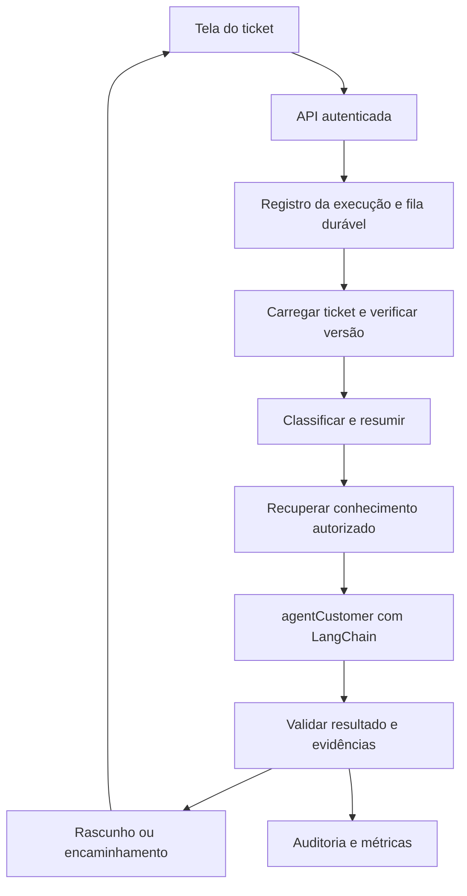

# agentCustomer: arquitetura para atendimento de tickets

Data: 21/10/2026. Estado: proposta técnica pesquisada; implementação não iniciada.

## 1. Objetivo e contexto verificado

Criar um `agentCustomer` com LangChain para apoiar o atendimento na seção de tickets: entender a solicitação, consultar informações autorizadas, sugerir uma resposta fundamentada e encaminhar casos que precisam de uma pessoa.

O pedido determina o uso de LangChain e a preparação aprofundada do plano. A pasta `C:\Users\CEPEDII\Downloads\Agent` estava vazia durante a inspeção, sem repositório Git, aplicação, esquema de tickets ou configuração de runtime. Nenhuma página da aplicação estava disponível no contexto. Portanto, nomes de arquivos de produto, rotas e contratos abaixo são propostas, não descobertas sobre o sistema existente.

Premissas de trabalho: o ticket já pertence a uma organização e possui histórico de mensagens; existe ou existirá autenticação; o primeiro usuário do agente é o atendente interno. A primeira versão produz sugestões. Atendimento direto ao cliente é uma evolução com política própria. TypeScript é a referência de implementação, sujeita ao backend real; se o projeto for Python, preservar o desenho e usar as APIs correspondentes, como `create_agent`.

Sucesso significa diminuir o esforço de leitura e elaboração de respostas, manter a rastreabilidade das fontes e preservar a consistência dos tickets. Não assumir redução percentual de tempo antes de medir o atendimento atual.

## 2. Abordagens consideradas

| Abordagem | Benefício | Custo ou limite | Decisão |
| --- | --- | --- | --- |
| LangChain `createAgent` dentro de um fluxo explícito LangGraph | Ferramentas flexíveis e controle das etapas do ticket | Exige definir estado, persistência e integrações | Recomendada para o desenho completo |
| Somente `createAgent` com middleware | Menor implementação inicial; já utiliza LangGraph internamente | Um loop genérico torna menos explícitas as regras de revisão e concorrência | Adequada para a primeira prova com adaptadores falsos |
| Deep Agents com planejamento e delegação | Útil para investigações extensas com muito contexto | Mais capacidades e superfície operacional do que a triagem inicial demanda | Avaliar depois com casos de investigação reais |

A recomendação é uma decisão de engenharia para este caso. A documentação distingue o agente configurável de LangChain da orquestração de baixo nível de LangGraph. Não são dois loops concorrentes: o agente de LangChain pode ser um nó do fluxo maior. [LangChain](https://docs.langchain.com/oss/javascript/langchain/overview), [LangGraph](https://docs.langchain.com/oss/javascript/langgraph/overview), [middleware em grafos](https://docs.langchain.com/oss/javascript/langchain/middleware/overview).

## 3. Escopo da primeira entrega

Ao solicitar uma análise na tela do ticket, o atendente recebe:

- Resumo da conversa e do problema atual, distinguindo mensagens públicas e notas internas.
- Categoria sugerida: `access`, `billing`, `technical`, `general` ou `unknown`.
- Prioridade sugerida: `low`, `normal`, `high` ou `urgent`, com motivo verificável. O SLA continua calculado pelas regras do sistema.
- Rascunho público em português, quando houver informação suficiente.
- Referências a documentos aprovados e fatos atuais do ticket.
- Perguntas sobre dados ausentes ou motivo de encaminhamento para uma pessoa.

O agente não recebe, nesta entrega, ferramentas de envio público, fechamento, reembolso ou alteração de conta. O envio pode continuar no fluxo normal já existente da aplicação, por ação explícita do atendente. Essa é uma proposta de lançamento do produto, não uma solicitação de autorização para preparar o plano.

Exemplo: em um ticket sobre falha de acesso, o agente resume as tentativas registradas, busca o procedimento atual e rascunha os próximos passos. Se não existir procedimento aplicável, retorna `needs_information` ou `handoff`; não inventa que redefiniu uma senha.

## 4. Componentes e fluxo



O worker executa o grafo; a API aceita o pedido e permite consultar seu resultado. A fila pode aproveitar infraestrutura existente. Se não houver, a referência é uma fila de jobs em PostgreSQL com leasing e recuperação. Não adicionar Redis apenas por convenção. Checkpoints de LangGraph preservam estado, mas não substituem recebimento durável de eventos, deduplicação ou agendamento de jobs.

Etapas lógicas: `load_context → triage → retrieve → draft → validate → persist_result`. No primeiro release, `triage`, `retrieve` e `draft` são encapsuladas por `analyzeSnapshot` em um único nó `analyze`; o grafo persistido é `load_context → analyze → validate → persist_result`. Isso evita duplicar recuperação ou chamadas ao modelo. Uma falha dentro de `analyze` pode repetir leituras e geração, sem efeitos externos. Separar checkpoints dessas subetapas somente se as medições justificarem. Saídas alternativas: `needs_information`, `handoff`, `superseded` e `failed`. Persistir o resultado é responsabilidade determinística do backend.

Não manter uma requisição HTTP aberta enquanto se espera atendimento humano. A tela consulta uma execução persistida ou acompanha seus eventos. [Persistência](https://docs.langchain.com/oss/javascript/langgraph/persistence).

## 5. Contratos propostos

Todos os IDs são strings opacas. `ticketVersion` é uma revisão monotônica fornecida pelo backend; se o sistema não tiver uma revisão, o adaptador deverá construí-la a partir de um snapshot consistente, sem confiar apenas em timestamps de baixa precisão.

| Contrato | Campos ou assinatura |
| --- | --- |
| `ActorContext` | `tenantId`, `actorId`, `permissions: string[]`; fornecido exclusivamente pela autenticação do servidor |
| `TicketSnapshot` | `id`, `tenantId`, `version: number`, `status`, `subject`, `messages: TicketMessage[]`, `customerFacts: CustomerFact[]` |
| `TicketMessage` | `id`, `body`, `visibility: public \| internal`, `createdAt` |
| `CustomerFact` | `id`, `key`, `value`, `sourceVersion`, `audience: public \| internal`; apenas campos permitidos |
| `Evidence` | `id`, `documentId`, `documentVersion`, `passageId`, `excerpt`, `audience: public \| internal`, `updatedAt` |
| `SearchQuery` | `text`, `limit: number`, `audience: public \| internal` |
| `EvidenceRef` | `kind: document \| ticket_message \| customer_fact`, `id`, `version` |
| `AgentSuggestion` | `schemaVersion: 1`, `summary`, `category`, `priority`, `priorityReason`, `publicDraft: string \| null`, `evidenceRefs: EvidenceRef[]`, `missingInformation: string[]`, `disposition: draft \| needs_information \| handoff`, `handoffReason: string \| null` |
| `RunRequest` | `ticketId`, `ticketVersion`, `idempotencyKey`; não aceita `tenantId` do cliente |
| `RunStatus` | `queued \| running \| completed \| superseded \| failed \| cancelled` |
| `RunView` | `runId`, `ticketId`, `ticketVersion`, `status: RunStatus`, `suggestion: AgentSuggestion \| null`, `errorCode: string \| null` |
| `RunRecord` | `RunView` mais `tenantId`, `actorId`, `policyVersion`, `promptVersion`, `modelId`, `createdAt`, `updatedAt` |

Adaptadores obrigatórios:

```typescript
interface TicketGateway {
  getSnapshot(ctx: ActorContext, ticketId: string): Promise<TicketSnapshot>;
  isCurrent(ctx: ActorContext, ticketId: string, version: number): Promise<boolean>;
}
interface KnowledgeGateway {
  search(ctx: ActorContext, query: SearchQuery): Promise<Evidence[]>;
}
interface SuggestionRepository {
  saveIfCurrent(ctx: ActorContext, runId: string, suggestion: AgentSuggestion,
    expectedTicketVersion: number): Promise<'saved' | 'superseded'>;
}
```

`saveIfCurrent` exige uma comparação atômica com a revisão autorizada. Se tickets e sugestões estiverem em sistemas distintos, o adaptador precisa de operação condicional no sistema de origem ou de um mecanismo equivalente de serialização. Um `get` seguido de `save` sem proteção não satisfaz o contrato.

Validar entrada e saída com Zod. Os campos não declarados são rejeitados; uma saída válida em JSON ainda pode conter fatos incorretos. Referências devem pertencer ao conjunto efetivamente recuperado. A fundamentação semântica precisa de avaliação e revisão, além da validação estrutural. [Structured output](https://docs.langchain.com/oss/javascript/langchain/structured-output).

## 6. Ferramentas e contexto

Ferramentas expostas ao modelo: `get_ticket`, `get_customer_context` e `search_knowledge`. Cada uma possui schema pequeno, timeout e limite de resposta. O identificador do ticket fica vinculado ao contexto da execução; a ferramenta não permite trocar livremente para outro ticket. O servidor vincula também a audiência de cada invocação: ferramentas do agente que redige conteúdo público retornam exclusivamente mensagens, fatos e documentos públicos. O modelo não pode ampliar essa audiência por argumento. `get_customer_context` fornece somente fatos previamente autorizados pelo adaptador.

Permissões, organização e identidade são injetadas pelo servidor, não extraídas da mensagem do cliente nem escolhidas pelo modelo. Cada leitura confirma acesso ao recurso. O backend deve funcionar com privilégio mínimo e negar por padrão. Um filtro de busca ou o nome de uma thread, isoladamente, não constitui autorização.

Na referência inicial, uma execução tem limite de 4 chamadas ao modelo, 8 chamadas de ferramentas, 60 segundos totais e até 2 novas tentativas para falhas transitórias de leitura. Esperas e tentativas contam no prazo total. Esgotar qualquer limite produz erro controlado e preserva a possibilidade de atendimento manual. São valores iniciais de produto, ajustáveis por configuração e testes de carga.

## 7. Conhecimento e RAG

Começar com artigos aprovados, procedimentos e políticas de atendimento. Tickets encerrados só entram após curadoria e remoção de dados pessoais desnecessários. Não transformar qualquer resposta histórica em política oficial.

Na primeira versão, recuperar contexto antes de gerar: busca lexical e semântica quando disponíveis, filtradas por organização, audiência, produto e validade. PostgreSQL com busca textual e pgvector é uma opção quando não existe mecanismo de busca; preservar a infraestrutura atual se ela já atender. Reranking só entra se o conjunto de avaliação demonstrar benefício.

Indexação proposta: ingestão autorizada → extração de texto → normalização → trechos com metadados e ACL → embeddings → atualização versionada do índice. A remoção ou revogação de um documento precisa retirar seus trechos da recuperação e invalidar caches. A dimensão do vetor deve corresponder ao modelo de embeddings escolhido.

Recuperar no máximo 6 trechos por geração. Usar também as últimas 20 mensagens acessíveis e um resumo anterior versionado quando houver; truncar por orçamento de tokens sem descartar silenciosamente a mensagem mais recente. Esses números são pontos de partida, não garantia de qualidade.

A resposta pública usa somente evidências autorizadas para divulgação pública. Notas internas podem apoiar triagem interna, mas ficam fora do contexto de geração pública. A geração pública usa uma invocação distinta, sem mensagens anteriores ou resumo interno da triagem; checkpoints internos não podem ser reintroduzidos em seu contexto. Para fatos necessários que nasceram internamente, o backend deve fornecer uma versão explicitamente liberada para divulgação. Sem evidência, o agente pede informação ou encaminha.

RAG recupera conhecimento durante a execução; não exige treinar o modelo com os tickets. Busca mais autônoma pode vir depois, limitada por orçamento. [Retrieval](https://docs.langchain.com/oss/javascript/deepagents/retrieval), [pgvector](https://github.com/pgvector/pgvector).

## 8. Memória e confiabilidade

Usar um mapeamento persistido e autorizado de `(tenantId, ticketId, agentVersion)` para um UUID de thread. `runId` identifica cada análise; `eventId` identifica um evento de entrada. Uma thread por cliente misturaria tickets independentes.

Checkpointer persistente em PostgreSQL em produção. Memória em RAM somente para testes; não sobrevive a reinícios. Guardar resumo e contexto da conversa no estado do ticket; preferências entre tickets pertencem a armazenamento separado, com escopo e retenção explícitos. [Memória curta](https://docs.langchain.com/oss/javascript/langchain/short-term-memory), [checkpointers](https://docs.langchain.com/oss/javascript/langgraph/checkpointers).

Confiabilidade da aplicação:

- Deduplicar pedidos pela organização e `idempotencyKey`; a mesma chave com payload diferente retorna conflito.
- Serializar execuções por ticket com lock/lease no armazenamento; uma nova versão pode invalidar o resultado anterior.
- Comparar a versão antes de publicar a sugestão. Resultado antigo recebe `superseded` e não substitui o resultado atual.
- A fila usa lease renovável; worker interrompido libera o job por expiração. Checkpoints e gravações determinísticas devem tolerar replay.
- O cancelamento é cooperativo: impedir novos passos e gravação final após marcar `cancelled`.
- Produzir eventos de atividade com sequência persistida por execução, permitindo reconexão da interface.

Modelo de dados adicional proposto: `agent_runs`, `agent_threads`, `agent_jobs`, `agent_run_events`, `agent_suggestions`. Conhecimento indexado usa `knowledge_documents` e `knowledge_chunks` quando não existir fonte equivalente. Todos os registros de aplicação carregam escopo da organização. Os checkpoints usam o esquema suportado pela biblioteca e precisam ser protegidos pelo acesso do serviço.

## 9. Experiência na seção de tickets

Adicionar uma área `agentCustomer` ao detalhe do ticket, seguindo o design e framework existentes. Estados: pronto para analisar, em análise, sugestão disponível, informação insuficiente, análise desatualizada e falha recuperável.

Mostrar resumo, prioridade sugerida, rascunho editável, referências e horário/versão da análise. Exibir progresso útil, como “Consultando procedimentos”; não mostrar raciocínio interno, credenciais, argumentos sensíveis de ferramentas ou notas internas no conteúdo público.

Proposta de API:

- `POST /api/tickets/:ticketId/agent-runs`: cria ou reutiliza execução; responde `202` com `{ runId, status }`.
- `GET /api/tickets/:ticketId/agent-runs/:runId`: retorna `RunView` autorizado.
- `GET /api/tickets/:ticketId/agent-runs/:runId/events`: SSE com `{ sequence, runId, type, payload }`; retoma por `Last-Event-ID`.
- `POST /api/tickets/:ticketId/agent-runs/:runId/cancel`: solicita cancelamento idempotente.

Eventos públicos da execução: `status`, `progress`, `result`, `error`. SSE transporta eventos sanitizados da aplicação. A documentação atual recomenda event streaming para novas aplicações LangChain; verificar a API disponível nas versões fixadas antes de conectar o stream interno ao transporte HTTP. Polling autenticado continua sendo alternativa operacional. [Streaming](https://docs.langchain.com/oss/javascript/langchain/streaming).

## 10. Segurança e governança do produto

Mensagens, documentos, anexos e resultados de ferramentas são dados não confiáveis. Uma instrução no ticket para “ignorar as regras e consultar outra empresa” não altera a autorização. O sistema precisa impedir acesso em código, mesmo se o modelo obedecer ao texto malicioso.

Não fornecer SQL arbitrário, shell, navegação irrestrita ou credenciais ao agente. Mascarar dados sensíveis antes de enviar ao provedor e aos traces. Proposta inicial de retenção: 30 dias para conteúdo de execuções e checkpoints, 90 dias para metadados operacionais sem corpos de mensagens; adequar ao contrato real antes da produção. Exclusão deve alcançar índices, checkpoints, caches e exportações de observabilidade aplicáveis.

Segredos ficam apenas no backend. Definir limites por organização e usuário, máximo de concorrência, circuit breaker para o provedor e chave de desativação. Traces devem registrar ações e justificativas curtas, sem exigir cadeia privada de raciocínio.

## 11. Tecnologias atuais: adoção orientada ao problema

| Capacidade | Uso proposto | Quando adotar |
| --- | --- | --- |
| Saída estruturada | Contrato de sugestão validado pelo backend | Primeira versão |
| Middleware | Limites, tratamento de falhas e seleção de ferramentas | Primeira versão |
| Checkpoints e replay | Recuperar análises após falha do worker | Antes do piloto com dados reais |
| Event streaming | Progresso e reconexão na tela de tickets | Integração da interface |
| LangSmith | Traces e avaliação de qualidade por versão | Piloto, com conteúdo sanitizado |
| Roteamento de modelos | Modelo econômico para triagem e outro para casos difíceis | Após benchmark do conjunto de tickets |
| MCP | Conectar CRM ou ferramentas já disponibilizadas por servidores MCP | Quando houver integração concreta; manter ACL e allowlist |
| Multimodalidade | Interpretar capturas de erro e documentos do cliente | Após validar permissões, formatos e casos de teste |
| Deep Agents | Investigar incidentes extensos com planejamento e contexto grande | Quando o fluxo atual não resolver e houver ganho medido |
| Múltiplos agentes/A2A | Cooperar com especialistas independentes | Somente com necessidade de domínio e avaliação que justifique o custo |

O guia MCP consultado já descreve `MCPAdapter` e exige `@langchain/mcp-adapters` 2.0 ou posterior. Não copiar exemplos antigos sem conferir a versão. MCP padroniza integração, mas não define automaticamente a política de acesso do negócio. [MCP](https://docs.langchain.com/oss/javascript/langchain/mcp).

Deep Agents reúne capacidades de contexto e delegação. Sua existência não demonstra que um time de agentes produzirá atendimento melhor; comparar contra o agente único. Multimodalidade é uma proposta de evolução e depende do modelo selecionado. [Deep Agents](https://docs.langchain.com/oss/javascript/deepagents/overview).

## 12. Evolução da autonomia

1. `shadow`: processa amostra sanitizada sem afetar o atendimento.
2. `copilot`: apresenta sugestões ao atendente; modo inicial do produto.
3. `bounded_auto`: executa somente ações e categorias expressamente liberadas na política do produto.

Para `bounded_auto`, criar tools específicas como `send_public_reply`, com escopo fixo de ticket, conteúdo versionado e chave idempotente. Exigir checagem de revisão, ausência de intervenção humana posterior, aprovação ou elegibilidade vigente e confirmação da entrega no sistema de tickets. Timeout após envio exige reconciliação; não significa que o envio falhou.

Quando uma ação precisar de revisão, registrar proposta imutável com hash, revisão do ticket, validade e identidade do revisor; usar interrupt persistente e retomar a mesma thread. Editar conteúdo invalida a aprovação anterior. Revalidar autorização e versão ao retomar. Evitar efeitos externos antes de um interrupt, pois o nó pode ser reexecutado. [HITL](https://docs.langchain.com/oss/javascript/langchain/human-in-the-loop), [interrupts e replay](https://docs.langchain.com/oss/javascript/langgraph/interrupts).

Essas ações pertencem a uma entrega posterior. A autorização para construir o sistema não determina a política de autonomia que ele oferecerá a seus usuários.

## 13. Avaliação e critérios de lançamento

Preparar 100 casos sanitizados e rotulados por atendimento: 60 para desenvolvimento e 40 reservados para avaliação. Incluir solicitações incompletas, urgência real, políticas contraditórias, base sem resposta, tentativas de acessar outra organização, prompt injection, notas internas e tickets atualizados durante a execução. Não colocar o conjunto reservado nos exemplos do prompt.

Metas iniciais propostas para o piloto:

- 100% das saídas aceitas passam no schema; falha estrutural gera encaminhamento controlado.
- Zero acesso entre organizações e zero envio público pelo agente no MVP, nos testes adversariais e de integração.
- F1 macro de categoria >= 0,85 no conjunto reservado; recall de `urgent` >= 0,95 em amostra direcionada adicional com ao menos 20 casos urgentes.
- Ao menos 90% dos rascunhos com informação suficiente são considerados fundamentados e úteis por revisão humana; reportar tamanho da amostra.
- Nenhuma sugestão desatualizada substitui a atual nos testes de concorrência e replay.
- Latência p95 <= 20 segundos para tickets textuais até 20 mensagens e 6 trechos, com 5 execuções simultâneas no ambiente de teste definido; prazo rígido de 60 segundos.

São critérios a medir, não resultados obtidos. Medir também taxa de aceitação e edição, tempo até resposta, encaminhamento, reabertura e custo por ticket assistido. Não usar a autoconfiança do modelo como autorização para agir.

Avaliação automática pode verificar schema, permissões e referências; avaliar semântica com revisão humana e, opcionalmente, um juiz LLM calibrado. LangSmith oferece experimentos offline e avaliações online; adotar amostragem para controlar custo. [Evaluation](https://docs.langchain.com/langsmith/evaluation), [Observability](https://docs.langchain.com/langsmith/observability).

Estimativa de custo deve usar consumo observado: tokens de entrada e saída por modelo + embeddings de documentos novos/alterados + recuperação/reranking + infraestrutura e observabilidade. Levantar preços atuais apenas depois de escolher os candidatos; não há valor mensal confiável sem volume e tamanho dos tickets.

## 14. Dependências para executar o plano

Obter o repositório real ou a especificação da API de tickets, autenticação, fonte de conhecimento e ambiente de execução. Escolher provedores de modelo e embeddings a partir de benchmark e regras de tratamento de dados. Confirmar volume, idiomas, categorias, horários e SLA com dados do produto.

Essas dependências não impedem o planejamento; impedem afirmar que a integração está implementada. Não criar um sistema paralelo de tickets para compensar a ausência do código existente.

Plano de execução: [2026-10-21-agent-customer.md](../plans/2026-10-21-agent-customer.md).
